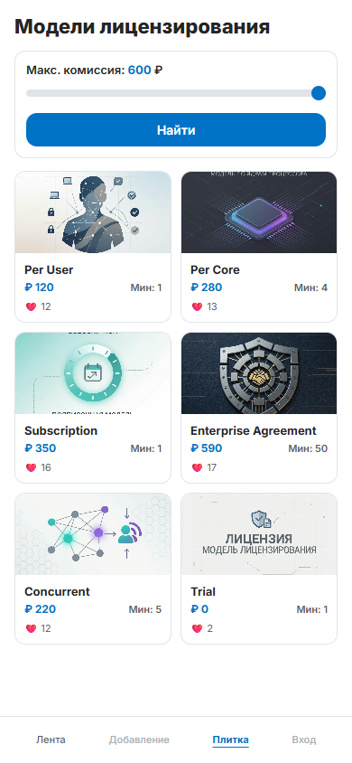
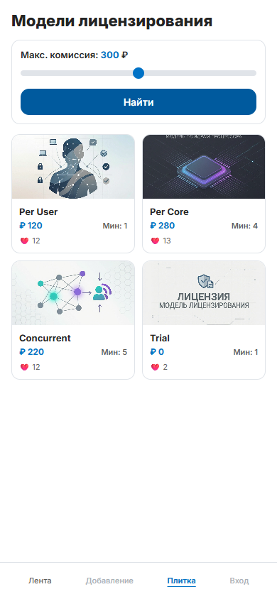
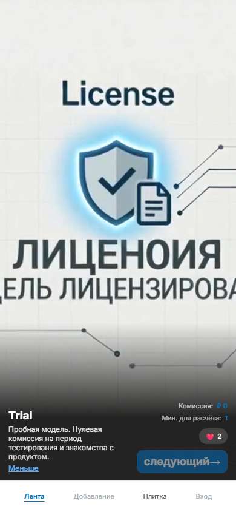
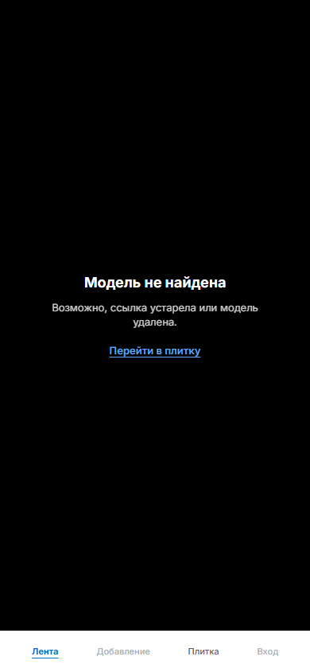

# Licensing-cost — фронтенд расчёта стоимости лицензирования

Фронтенд лабораторной работы №5 по курсу «Проектирование систем и продуктовая
веб-разработка» (ИУ5, МГТУ им. Н. Э. Баумана).

**Тема:** расчёт стоимости лицензирования ПО в зависимости от модели. Услуга —
модель лицензирования (`per_user`, `per_core`, `subscription`, `enterprise`,
`concurrent` и т. д.). Гость просматривает ленту и плитку моделей.

**Стек:** React 19, TypeScript, Vite, React Router, React Bootstrap + Bootstrap,
архитектура Feature-Sliced Design (FSD). Без Redux и без `React.Context` —
в лабораторной 5 состояние живёт в компонентах и в URL.

## Что реализовано

- три страницы: **Лента** (`/`), **Плитка** (`/grid`), **Подробнее**
  (`/licensing/:id`);
- содержимое карточек берётся из коллекции **mock-объектов**, бэкенд для запуска
  не нужен;
- плитка с фильтром по максимальной комиссии (слайдер 0–600 ₽) и кнопкой
  «Найти»;
- изображение и видео **по умолчанию** из самого проекта, если в модели пустые
  поля `image_url` / `video_url`;
- нижняя таб-панель из четырёх пунктов: **Лента**, **Добавление**, **Плитка**,
  **Вход**; доступны только «Лента» и «Плитка», остальные отключены до
  лабораторной 6;
- дизайн сохранён по SSR-шаблонам прошлых лабораторных (`Licensing-cost-backend`)
  и медиа из MinIO;
- проект разложен по слоям FSD с публичными API каждого слайса.

## Быстрый старт

Требуется Node.js `^20.19` или `>=22.12` (проверено на Node 24).

```bash
npm install
npm run dev
```

Приложение откроется на [http://localhost:3000](http://localhost:3000)
(порт зафиксирован в `vite.config.ts`).

Другие команды:

```bash
npm run build     # проверка типов + production-сборка
npm run preview   # предпросмотр production-сборки
npm run lint      # oxlint
```

### Docker

```bash
docker compose up --build
```

Контейнер поднимает Vite dev-сервер на том же порту `3000` и монтирует текущую
директорию в `/app`. Для лабораторной 5 прокси к бэкенду не используется,
поэтому mock-режим работает без дополнительных сервисов.

## Скриншоты

<p align="center">
  
  
  
</p>

<p align="center">
  
  
  
</p>

## Страницы приложения

### 1. Лента — `/`

Полноэкранная карточка модели в стиле мобильной ленты: видео на весь экран,
поверх него — описание и параметры расчёта.

| Элемент | Назначение / поведение |
| --- | --- |
| Видео модели | Проигрывается автоматически без звука, зациклено. Если `video_url` пустой — подставляется `/media/default_video.mp4`. Если видео не загрузилось — показывается обложка (или дефолтное изображение) |
| Заголовок модели | Название модели (`title`), по умолчанию «Без названия» |
| Описание | Короткий текст в две строки с обрезкой; кнопка **«Ещё»** раскрывает полный текст, **«Меньше»** сворачивает обратно |
| «Комиссия» | `commission_per_unit` в рублях |
| «Мин. для расчёта» | `min_for_calc` |
| Лайки | Счётчик `likes_count` (в лабораторной 5 только отображение) |
| **«следующий→»** | Переход к следующей модели в порядке коллекции. На последней модели кнопка недоступна |
| Нижняя навигация | Активна вкладка «Лента» |

Лента начинает показ с первой опубликованной модели и хранит текущий индекс в
`useState`; при нажатии «следующий→» видео и текст меняются без перезагрузки
страницы.

### 2. Плитка — `/grid`

Каталог моделей в две колонки. Внешний вид повторяет SSR-шаблон
`templates/licensingsGrid.html`.

| Элемент | Назначение / поведение |
| --- | --- |
| Заголовок | «Модели лицензирования» |
| Подпись фильтра | «Макс. комиссия: N ₽» — текущее значение слайдера |
| Слайдер | Диапазон 0–600 ₽, шаг 10 ₽ |
| **«Найти»** | Применяет выбранное значение фильтра к списку |
| Карточка: изображение | `image_url`; при пустом поле или ошибке загрузки — `/media/default_image.png` |
| Карточка: название | `title` |
| Карточка: цена | `commission_per_unit` |
| Карточка: минимум | «Мин: N» |
| Карточка: лайки | «❤️ N» |
| Клик по изображению | Переход на страницу «Подробнее» (`/licensing/:id`) |
| Пустой результат | Сообщение «Ничего не найдено» с подсказкой увеличить комиссию |

Фильтр применяется по кнопке, а не в процессе перетаскивания — как в
методических указаниях и прошлых лабораторных. Значение `0` повторяет
поведение бэкенда: фильтр не ограничивает список. Карточки раскладываются по
колонкам с чередованием индексов (как в SSR-шаблоне).

### 3. Подробнее — `/licensing/:id`

Та же полноэкранная карточка, что и лента, но открытая по конкретному `id`
(например, после клика по карточке в плитке).

| Элемент | Назначение / поведение |
| --- | --- |
| Видео / обложка | Аналогично ленте; при пустых медиа — дефолтные файлы проекта |
| Описание | Сразу развёрнуто целиком; кнопка **«Меньше»** сворачивает до двух строк |
| Параметры | Комиссия, минимальное число для расчёта, лайки |
| **«следующий→»** | Переход к следующей модели в коллекции; на последней модели кнопка недоступна |
| Некорректный `id` | Экран «Модель не найдена» со ссылкой «Перейти в плитку» |
| Нижняя навигация | Активна вкладка «Лента» (страница относится к ленте) |

### Нижняя навигация

| Пункт | Маршрут | Доступность в лабораторной 5 |
| --- | --- | --- |
| Лента | `/` | доступен |
| Добавление | — | отключён до лабораторной 6 |
| Плитка | `/grid` | доступен |
| Вход | — | отключён до лабораторной 6 |

Панель закреплена снизу, имеет высоту 52 px и не прокручивается вместе с
контентом. Активный пункт выделяется цветом `#0072c6` и подчёркиванием.

## Дизайн

Дизайн намеренно не переделывался: за основу взяты шаблоны и стили прошлых
лабораторных из репозитория `Licensing-cost-backend` (ветки `ssr-in-memory`,
`database`, `web-service-api`, `web-service-auth`).

- мобильная колонка **390 × 844 px**, центрированная на странице;
- шрифт **Inter** (локально через `@fontsource/inter`);
- нижняя таб-панель высотой 52 px;
- палитра: `#0072c6` — акцент, `#242424` — основной текст, `#5C5C5C` — вторичный,
  `#E0E4E9` — границы;
- лента: полноэкранное видео `object-fit: cover` и нижний градиент с текстом;
- плитка: карточки с изображением 90 px, скруглением 12 px и границей
  `#E0E4E9`.

Изображения и видео моделей перенесены из MinIO прошлых лабораторных в
`public/media/licensing/`, поэтому карточки выглядят как в лабораторных 1–4.
Файлы медиа по умолчанию лежат в `public/media/`.

## Архитектура FSD

### Слои

| Слой | Где | Ответственность |
| --- | --- | --- |
| `app` | `src/app` | точка входа, роутер, глобальные стили |
| `pages` | `src/pages` | композиция страниц: `feed`, `grid`, `licensing` |
| `widgets` | `src/widgets/app-layout` | мобильная оболочка и нижняя навигация |
| `features` | `src/features/licensing-filter` | фильтр плитки по комиссии |
| `entities` | `src/entities/licensing` | домен модели лицензирования: типы, mock, API, карточка и слайд |
| `shared` | `src/shared` | маршруты, env, утилиты форматирования и медиа, `PageLoader`, `StateScreen` |

Правила, которые соблюдаются в проекте:

- импортировать можно только слои **ниже** (`app → pages → widgets → features →
  entities → shared`), обратных зависимостей нет;
- между слайсами одного слоя импорт идёт только через публичный `index.ts`;
- внутри слайса разрешены относительные импорты между сегментами
  (`model`, `ui`, `api`, `lib`, `config`);
- алиас `@/` указывает на `src/` и настроен в `tsconfig.app.json` и
  `vite.config.ts`;
- в лабораторной 5 нет ни Redux, ни `React.Context`.

### Дерево

```text
src/
├── app/
│   ├── providers/
│   │   └── AppRouter.tsx          # BrowserRouter + маршруты
│   ├── styles/
│   │   └── global.css             # reset, Inter, мобильная оболочка
│   ├── App.tsx
│   └── index.ts
├── pages/
│   ├── feed/
│   │   ├── ui/FeedPage.tsx
│   │   └── index.ts
│   ├── grid/
│   │   ├── ui/GridPage.tsx
│   │   ├── ui/GridPage.css
│   │   └── index.ts
│   └── licensing/
│       ├── ui/LicensingPage.tsx
│       └── index.ts
├── widgets/
│   └── app-layout/
│       ├── ui/AppLayout.tsx
│       ├── ui/AppLayout.css
│       ├── ui/BottomNavigation.tsx
│       ├── ui/BottomNavigation.css
│       └── index.ts
├── features/
│   └── licensing-filter/
│       ├── model/constants.ts
│       ├── ui/LicensingFilter.tsx
│       ├── ui/LicensingFilter.css
│       └── index.ts
├── entities/
│   └── licensing/
│       ├── api/
│       │   ├── types.ts
│       │   ├── mockLicensingRepository.ts
│       │   ├── httpLicensingRepository.ts
│       │   └── index.ts
│       ├── model/
│       │   ├── types.ts
│       │   ├── mock.ts
│       │   ├── selectors.ts
│       │   └── useLicensings.ts
│       ├── ui/
│       │   ├── LicensingCard/
│       │   └── LicensingSlide/
│       └── index.ts
└── shared/
    ├── config/
    │   ├── env.ts
    │   ├── routes.ts
    │   └── index.ts
    ├── lib/
    │   ├── format.ts
    │   ├── media.ts
    │   └── index.ts
    └── ui/
        ├── PageLoader/
        ├── StateScreen/
        └── index.ts
```

## Данные: mock и API

### Mock-коллекция

`src/entities/licensing/model/mock.ts` содержит пять опубликованных моделей из
первой лабораторной (ветка `ssr-in-memory`) с теми же названиями, описаниями,
комиссиями и количеством лайков, а также карточку `Trial` для демонстрации
дефолтных медиа.

| ID | Модель | Комиссия | Мин. | Лайки | Медиа |
| --- | --- | --- | --- | --- | --- |
| 1 | Per User | 120 ₽ | 1 | 12 | `per_user.jpg` / `per_user.mp4` |
| 2 | Per Core | 280 ₽ | 4 | 13 | `per_core.jpg` / `per_core.mp4` |
| 3 | Subscription | 350 ₽ | 1 | 16 | `subscription.jpg` / `subscription.mp4` |
| 4 | Enterprise Agreement | 590 ₽ | 50 | 17 | `enterprise.jpg` / `enterprise.mp4` |
| 5 | Concurrent | 220 ₽ | 5 | 12 | `concurrent.jpg` / `concurrent.mp4` |
| 6 | Trial | 0 ₽ | 1 | 2 | пусто → дефолтные медиа |

`Trial` добавлен как опубликованная карточка с пустыми `image_url` и
`video_url`, чтобы на реальном примере показать подстановку дефолтных
изображения и видео (п. 7.2 методических указаний).

### Репозиторий данных

Слой `entities/licensing/api` скрывает источник данных за интерфейсом
`LicensingRepository`:

- `mockLicensingRepository` — отдаёт mock-коллекцию с небольшой задержкой
  (имитация сети, нужна для состояния загрузки). Именно он работает по
  умолчанию в лабораторной 5;
- `httpLicensingRepository` — запрашивает `GET /api/licensings` у Go-сервиса
  из лабораторных 3–4;
- `api/index.ts` выбирает реализацию по переменной `VITE_API_MODE`.

### Переключение на API (задел лабораторной 6)

По умолчанию `VITE_API_MODE=mock`, поэтому вкладка Network показывает только
статические файлы и шрифты — без запросов к бэкенду, как требуется в
лабораторной 5.

Чтобы подключить собственный веб-сервис:

1. Запустить бэкенд из `Licensing-cost-backend`:
   ```bash
   docker compose up -d
   go run ./cmd/migrate
   go run ./cmd/licensing-calc
   ```
2. Создать `.env.local` на основе `.env.example`:
   ```dotenv
   VITE_API_MODE=api
   VITE_API_BASE_URL=/api
   ```
3. Перезапустить `npm run dev`.

Запросы к `/api` проксируются Vite на `http://localhost:8080` (настройка в
`vite.config.ts`), поэтому CORS не нужен. Формат ответа
`GET /api/licensings` совпадает с типом `Licensing` (`id`, `title`,
`description`, `image_url`, `video_url`, `commission_per_unit`, `min_for_calc`,
`likes_count` и т. д.).

## Дефолтные изображение и видео

- изображение: `public/media/default_image.png`;
- видео: `public/media/default_video.mp4`;
- утилиты подстановки: `src/shared/lib/media.ts`
  (`resolveImageUrl`, `resolveVideoUrl`);
- в карточке плитки `LicensingCard` есть `onError`: если URL изображения не
  загрузился, подставляется дефолтная картинка;
- в полноэкранной карточке `LicensingSlide` при ошибке видео показывается
  обложка (или дефолтное изображение);
- у модели `Trial` оба поля пустые, поэтому она наглядно демонстрирует оба
  fallback-сценария.

## Хуки

| Хук | Где | Зачем |
| --- | --- | --- |
| `useState` | `FeedPage`, `GridPage`, `LicensingSlide` | текущая карточка ленты, значения фильтра, раскрытие описания, ошибка видео |
| `useEffect` | `useLicensings` | загрузка данных при монтировании с флагом отмены для размонтирования |
| `useMemo` | `GridPage` | отфильтрованный список и раскладка по колонкам |
| `useParams` | `LicensingPage` | `id` модели из адреса |
| `useNavigate` | `LicensingPage` | переход к следующей модели |
| `useLocation` | `BottomNavigation` | подсветка активной вкладки |
| `useLicensings` | `entities/licensing/model` | собственный хук загрузки списка моделей |

## Проверка

- `npm run lint` — 0 предупреждений и ошибок;
- `npm run build` — успешная проверка TypeScript и production-сборка;
- UI-проверка в headless Chrome (390 × 844):
  - ширина приложения 390 px, горизонтального переполнения нет;
  - в коллекции 6 карточек;
  - фильтр 300 ₽ оставляет 4 карточки, 50 ₽ — одну (`Trial`);
  - переход по карточке открывает `/licensing/1`, кнопка «следующий→» ведёт на
    `/licensing/2`;
  - на последней модели кнопка «следующий→» отключена;
  - в нижней навигации 2 ссылки и 2 отключённых пункта;
  - ошибок в консоли и HTTP-ответов ≥ 400 нет.

## Что дальше (лабораторная 6)

Задел уже подготовлен: источник данных вынесен в репозиторий, а маршруты и
слои FSD позволяют добавить без переделки:

- авторизацию и переключение интерфейса гостя/пользователя (`features/auth`,
  `entities/session`);
- страницу добавления модели и действия «лайк»/«удалить»;
- `Redux Toolkit` для фильтров и состояния сессии, `axios` + кодогенерацию из
  Swagger и `redux-thunk` для запросов;
- проксирование MinIO вторым маршрутом Vite (`/s3` → `localhost:9000`).

## Полезные ссылки

- [Методические указания по лабораторной 5](https://github.com/iu5git/Web/tree/main/tutorials/lab5);
- [React](https://react.dev), [React Router](https://reactrouter.com),
  [Vite](https://vite.dev), [React Bootstrap](https://react-bootstrap.github.io),
  [Feature-Sliced Design](https://feature-sliced.design).
